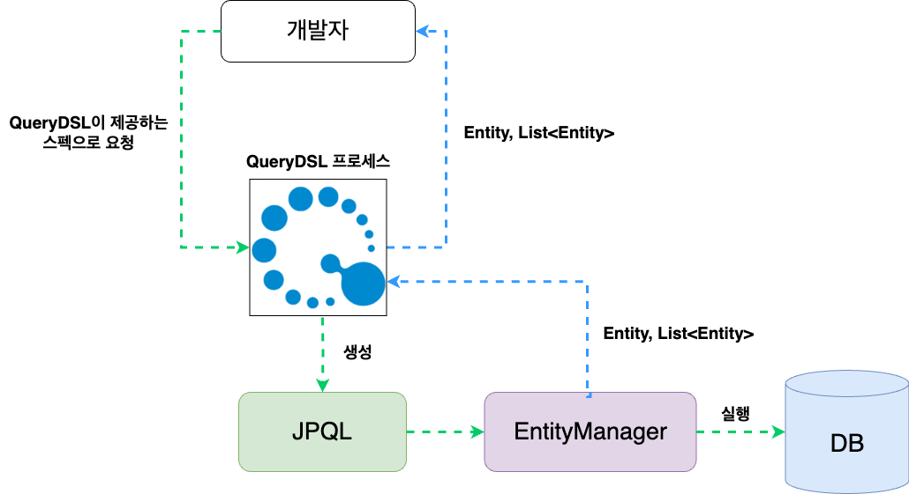

# QueryDSL이란?
QueryDSL은 자바 기반 프레임 워크로 SQL, JPQL 등을 코드로 더 편하게 작성할 수 있도록 해주는 빌더 오픈소스 프레임워크다.

***JPQL** : 객체지향 쿼리로 JPA가 지원하는 다양한 퀴리 방법 중 하나

자바 백엔드 기술은 Spring Boot와 Spring Data JPA를 함께 사용한다. 하지만 복잡한 쿼리, 동적 쿼리를 구현하는 데 있어 한계가 있다. 이러한 문제점을 해결할 수 있는 것이 QueryDSL이다.

Query DSL이 나오기 전에는 문자열 형태로 쿼리문을 작성하여 **컴파일 시 오류를 발견하는게 불가능했음**
하지만 Query DSL은 자바 코드로 SQL문을 작성할 수 있어 컴파일 시에 오류를 발생하여 잘못된 쿼릭 실행되는 것을 방지할 수 있다.

---

## QueryDSL 장점
- 문자가 아닌 코드로 쿼리 작성할 수 있어 컴파일 시 문법 오류를 확인할수있음
- 인텔리제이와 같은 IDE의 자동 완성 기능의 도움을 받을 수 있다.
- 쿼리 작성이 편-해진다
- 자주 쓰이는 복잡한 쿼리 조건들을 하나의 함수로 묶어두고, 여러 쿼리에서 블록처럼 끼워 넣어 중복 없이 편리하게 재사용할수있다.
- JPQL 문법과 유사한 형태로 작성할 수 있어 쉽게 적응 가능하다.

---

## QueryDSL 단점
- 초기 설정(셋업)이 복잡하고 귀찮다.
- 프로젝트 빌드(Build) 과정에 의존한다.
- JPA(JPQL)의 한계를 그대로 물려받는다.

---

## QueryDSL 작동원리

- QueryDSL 작동원리

QueryDSL은 자바 코드로 쿼리를 짜기 위해, 개발자가 만든 엔티티(예: Member.java)를 바탕으로 QMember.java라는 특수한 복제 클래스(Q클래스)를 자동으로 생성한다. 개발자는 이 Q클래스를 조립하여 쿼리를 작성하며, 전체적인 실행 흐름은 다음과 같다.

### 요청과 변환 흐름
1. **개발자 -> QueryDSL:** 개발자가 자바 코드(QueryDSL 스펙 및 Q클래스)로 안전하게 쿼리를 작성하여 요청한다.
2. **QueryDSL -> JPQL:** QueryDSL 프로세스가 개발자가 짠 코드를 분석하여 JPQL 문장으로 자동으로 생성한다.
3. **JPQL -> EntityManager:** 생성된 JPQL이 JPA의 핵심 본체인 EntityManager로 전달된다.
4. **EntityManager -> DB:** EntityManager가 JPQL을 현재 연결된 데이터베이스(MySQL, Oracle 등) 문법에 맞는 진짜 SQL로 최종 번역하여 DB를 실행시킨다.

### 결과 반환 흐름
* 데이터베이스(DB)에서 조회된 데이터는 다시 JPA를 거쳐 자바 객체 형태인 Entity 또는 List<Entity>로 매핑되어 개발자에게 안전하게 반환된다.

---
  
# 정리
> **"QueryDSL은 결국 데이터베이스가 실행할 SQL을, 자바 개발자가 오타 없이 안전하고 편리하게 조립할 수 있도록 돕는 최고의 쿼리 조립 도구이다."**
